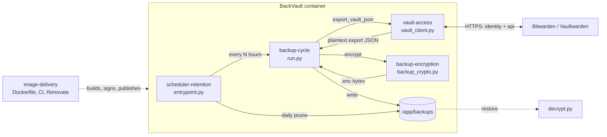

# High-Level Design: BackVault

## Problem

A Bitwarden or Vaultwarden vault is a single point of failure for every credential a person owns. Self-hosted Vaultwarden in particular has no vendor-side backup: if the host dies, the vault dies with it. The operator needs a copy of the vault that is taken automatically, protected at rest with a password they control, and restorable into a fresh Vaultwarden through the standard "Import data → Bitwarden (json)" path with no dependence on the server that was lost.

## Approach

BackVault is a long-running container that, on a fixed interval, authenticates to the vault server, exports the vault as Bitwarden-format JSON, encrypts it with a password, writes it to a mounted directory, and logs out. Once a day it prunes files older than a retention window. A standalone Python script decrypts any backup with two common libraries.

The export is obtained by a native Python client that speaks the Bitwarden API directly: authenticate with the API key (the token response carries the account's KDF parameters), derive the master key, unwrap the user key, pull `/api/sync`, decrypt the ciphers locally, and emit the same JSON shape the official CLI's `bw export --format json` produces. Because no third-party binary is involved, the runtime image holds only Python and runs under Docker's default seccomp profile.

## Target Users

A self-hosting Vaultwarden operator running the service under Docker Compose on a home or small-team server. They need backups to happen unattended and, when the vault host is gone, a restore they can perform under stress with commodity tools: Python, two libraries, the file password, and the Bitwarden web vault's import page. Bitwarden Cloud users are served secondarily; the same pipeline works against the hosted service.

## Goals

- Every scheduled interval produces a new backup file that decrypts and imports cleanly into a fresh Vaultwarden.
- Restoring needs only Python, `cryptography`, `argon2-cffi`, and the file password. No Bitwarden CLI, no network.
- The image runs under Docker's default seccomp profile and contains no runtime beyond Python.
- A failed backup cycle never stops future cycles.

## Non-Goals

- Not a general vault client. BackVault reads the vault once per cycle and never writes to it.
- Not a sync or replication tool. Output is a point-in-time file, not a mirror.
- Not an off-site transport. Pushing backups elsewhere is left to tools such as `restic` or `rclone`.
- Not multi-platform. The image targets `linux/amd64` only.
- Not a restore automation. Restoring is a manual import of the decrypted JSON.

## Tenets

Ordered: when two conflict, the higher one wins.

- **Restorable beats hardened.** When a security or footprint improvement risks the import-compatible restore path, the restore path wins.
- **Portable beats native.** Prefer formats and tools restorable with commodity software over vendor-native ones.
- **Match the reference, don't improve it.** Where our output could differ from what Bitwarden's own tooling produces, reproduce Bitwarden's shape rather than normalize it.
- **Pinned beats fresh.** Prefer pinned, verified inputs over always-latest, even for security tooling.

## System Design

Five leaf segments sit directly under this document (flat depth-2 tree):

| Segment | Owns | Prefix |
|---------|------|--------|
| [vault-access](intent/vault-access/vault-access-design.md) | Session with the server; producing the export | `VAULT` |
| [backup-encryption](intent/backup-encryption/backup-encryption-design.md) | The `.enc` format; the restore tool | `ENC` |
| [backup-cycle](intent/backup-cycle/backup-cycle-design.md) | One backup run: config intake, mode, naming, placement, exit status | `CYCLE` |
| [scheduler-retention](intent/scheduler-retention/scheduler-retention-design.md) | Interval loop, signals, daily prune | `SCHED` |
| [image-delivery](intent/image-delivery/image-delivery-design.md) | Container image, Compose reference, CI, dependency policy | `IMAGE` |

Segment status and next actions live in [docs/arrows/index.yaml](arrows/index.yaml).

**Cross-cutting concerns observed:**

- *Secrets* enter as environment variables, never appear in logs or on a command line, and never leave the process; derived keys and the access token are discarded at the end of each cycle.
- *Filesystem containment* is enforced at two layers (directory under `/app`; file under the backup directory with a strict filename) in the backup cycle, but not yet in cleanup.
- *Failure handling* is fail-fast within a cycle and survive-and-continue across cycles.
- *Logging* is stdout via `logging.basicConfig`, configured redundantly in three modules.

## Key Design Decisions

Decisions 2, 4, 5, and 6 are `[inferred]` from code unless their rationale was found written in the repository.

1. **Speak the Bitwarden API natively in Python, replacing the `bw` CLI in one change series.** The client implements prelogin, KDF, OAuth, sync, and cipher decryption itself and emits the CLI's export JSON shape. *Alternatives:* keep driving `bw` (reference-correct output for free, but a pkg-bundled Node binary that needs `seccomp=unconfined`, an unpinned download, and a Node CVE surface); `rbw`, a Rust client (no export command); a strangler period running both clients and diffing their output each cycle (safer convergence, but two code paths and the seccomp relaxation persist for several releases); hardening `bw` in place with a pinned checksum and a custom seccomp profile (zero functional risk, Node surface stays). *Rationale:* removing the binary in one series ends the seccomp relaxation and the unverified download at once and leaves a single code path to test. Import compatibility is verified by an operator drill rather than a runtime mode: decrypt a real backup, import it into a scratch Vaultwarden, compare counts, and optionally diff against `bw export --format json` of the same vault. The drill is the restore guarantee's only evidence and should be run after any change to the export shape (tenets: *Restorable beats hardened*, *Match the reference, don't improve it*).
2. **Encrypt in memory with a portable format.** Raw mode produces `version ‖ salt ‖ nonce ‖ AES-256-GCM`, keyed by Argon2id, so a backup is restorable with Python and two libraries and no Bitwarden tooling. The format is versioned; v1 (PBKDF2) remains readable. `[inferred]`
3. **One portable file format.** Portability for disaster recovery outranks Bitwarden's native encrypted export, so the service produces only the raw-mode `.enc` file. A stale `BACKUP_ENCRYPTION_MODE=bitwarden` setting stops the cycle with an explanation rather than silently changing the restore procedure.
4. **Distroless, non-root runtime with a Python supervisor.** Chainguard's shell-less image forced the cron/shell entrypoint to become `entrypoint.py`. Module docstring and Dockerfile header carry this rationale.
5. **Pin everything, let Renovate move it.** Digests for images, `uv.lock` for Python, cosign + SBOM + provenance on publish, automerge for low-risk updates. The `bw` download is the one unpinned exception. `[inferred]`
6. **One session per cycle, always logged out; cycles never kill the service.** Short-lived credentials in the container, and a transient outage never stops future backups. `[inferred]`

## Success Metrics

- A periodic restore drill imports the latest backup into a scratch Vaultwarden and the item count (and folder count) matches the source vault. Failure of this drill means the project is broken, whatever else passes.
- The container starts and completes a cycle with no `security_opt` in the Compose file.
- Image vulnerability scans report no findings attributable to a Node runtime.
- In raw mode, no plaintext vault data is ever written to disk; only `.enc` files appear in the backup directory.
- A deliberately unreachable server for one interval produces exactly one logged failed cycle and a successful cycle at the next interval.

## References

- Segment LLDs under `docs/intent/`, arrow docs under `docs/arrows/`.
- Bitwarden CLI: https://bitwarden.com/help/cli/
- Bitwarden import formats: https://bitwarden.com/help/import-data/
- Vaultwarden: https://github.com/dani-garcia/vaultwarden
