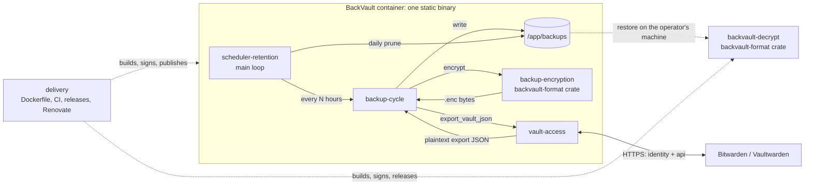

# High-Level Design: BackVault

## Problem

A Bitwarden or Vaultwarden vault is a single point of failure for every credential a person owns. Self-hosted Vaultwarden in particular has no vendor-side backup: if the host dies, the vault dies with it. The operator needs a copy of the vault that is taken automatically, protected at rest with a password they control, and restorable into a fresh Vaultwarden through the standard "Import data → Bitwarden (json)" path with no dependence on the server that was lost.

## Approach

BackVault is a long-running container that, on a fixed interval, authenticates to the vault server, exports the vault as Bitwarden-format JSON, encrypts it with a password, writes it to a mounted directory, and logs out. Once a day it prunes files older than a retention window.

The service is a single static Rust binary. A second, separately released binary, `backvault-decrypt`, opens any backup on the operator's own machine; it is never shipped in the image, because the image has no shell and restoring must not depend on the thing being recovered. Both binaries link one `backvault-format` library crate, so the bytes the service writes and the bytes the restore tool reads are defined in exactly one place.

The export is obtained by a native client that speaks the Bitwarden API directly: authenticate with the API key (the token response carries the account's KDF parameters), derive the master key, unwrap the user key, pull `/api/sync`, decrypt the ciphers locally, and emit the same JSON shape the official CLI's `bw export --format json` produces. Because no third-party binary or interpreter is involved, the runtime image holds one executable and runs under Docker's default seccomp profile.

## Target Users

A self-hosting Vaultwarden operator running the service under Docker Compose on a home or small-team server. They need backups to happen unattended and, when the vault host is gone, a restore they can perform under stress with commodity tools: the `backvault-decrypt` binary for their laptop, the file password, and the Bitwarden web vault's import page. Bitwarden Cloud users are served secondarily; the same pipeline works against the hosted service.

## Goals

- Every scheduled interval produces a new backup file that decrypts and imports cleanly into a fresh Vaultwarden.
- Restoring needs only the `backvault-decrypt` binary for macOS or Linux and the file password. No container runtime, no Bitwarden CLI, no interpreter, no network.
- Every backup ever written by any released version of the service, in any format version, stays readable by the current restore tool.
- The image runs under Docker's default seccomp profile and contains nothing beyond one static executable.
- A failed backup cycle never stops future cycles.

## Non-Goals

- Not a general vault client. BackVault reads the vault once per cycle and never writes to it.
- Not a sync or replication tool. Output is a point-in-time file, not a mirror.
- Not an off-site transport. Pushing backups elsewhere is left to tools such as `restic` or `rclone`.
- Not multi-platform for the service. The image targets `linux/amd64` only.
- Not a Windows restore target. The restore tool is released for macOS and Linux; the format is documented so a reader for any other platform can be written from the spec.
- Not a restore automation. Restoring is a manual import of the decrypted JSON.

## Tenets

Ordered: when two conflict, the higher one wins.

- **Restorable beats hardened.** When a security or footprint improvement risks the import-compatible restore path, the restore path wins. When the service and the restore tool want different platforms, dependencies, or build complexity, the restore tool's portability wins.
- **Portable beats native.** Prefer formats and tools restorable with commodity software over vendor-native ones.
- **The format is the contract, not the tool.** Any reader that honors the documented `.enc` layout is legitimate; the layout stays simple enough to reimplement from the spec in an afternoon.
- **Match the reference, don't improve it.** Where our output could differ from what Bitwarden's own tooling produces, reproduce Bitwarden's shape rather than normalize it.
- **Pinned beats fresh.** Prefer pinned, verified inputs over always-latest, even for security tooling.
- **Small tree beats convenient crate.** Prefer the standard library and single-purpose crates over frameworks unless the framework is decisively better; every crate in `Cargo.lock` is attack surface the restore tool may carry too.

## System Design

The repository is one Cargo workspace:

| Crate | Kind | Holds |
|-------|------|-------|
| `backvault-format` | library | The `.enc` layout, key derivation, encrypt and decrypt. No IO, no network. |
| `backvault` | binary | The service: vault client, backup cycle, scheduler, retention. |
| `backvault-decrypt` | binary | The restore tool: password prompt, file IO, and a call into `backvault-format`. |

Five leaf segments sit directly under this document (flat depth-2 tree):

| Segment | Owns | Prefix |
|---------|------|--------|
| [vault-access](intent/vault-access/vault-access-design.md) | Session with the server; producing the export | `VAULT` |
| [backup-encryption](intent/backup-encryption/backup-encryption-design.md) | The `.enc` format (`backvault-format`); the restore tool (`backvault-decrypt`) | `ENC` |
| [backup-cycle](intent/backup-cycle/backup-cycle-design.md) | One backup run: config intake, mode, naming, placement, exit status | `CYCLE` |
| [scheduler-retention](intent/scheduler-retention/scheduler-retention-design.md) | Interval loop, signals, daily prune | `SCHED` |
| [delivery](intent/delivery/delivery-design.md) | Container image, Compose reference, restore-tool releases, CI, dependency policy | `IMAGE` |

Segment status and next actions live in [docs/arrows/index.yaml](arrows/index.yaml).

**Cross-cutting concerns:**

- *Secrets* enter as environment variables or an interactive prompt, never appear in logs or on a command line, and never leave the process. Passwords, derived keys, and the access token live in zeroizing containers and are wiped when dropped, at the latest at the end of each cycle.
- *Filesystem containment* is enforced at two layers (directory under `/app`; file under the backup directory with a strict filename) for both writing and pruning.
- *Failure handling* is fail-fast within a cycle and survive-and-continue across cycles. Errors are typed per segment and carry no secret material in their display form.
- *Logging* is line-oriented text on stdout, initialized once at the service entry point.

## Key Design Decisions

1. **Speak the Bitwarden API natively, no CLI.** The client implements prelogin, KDF, OAuth, sync, and cipher decryption itself and emits the CLI's export JSON shape. *Alternatives:* drive the official `bw` CLI (reference-correct output for free, but a pkg-bundled Node binary that needs `seccomp=unconfined`, an unpinned download, and a Node CVE surface); `rbw`, a third-party Rust client (no export command); harden `bw` in place with a pinned checksum and a custom seccomp profile (zero functional risk, Node surface stays). *Rationale:* owning the client ends the seccomp relaxation and the unverified download and leaves a single code path to test. The restore guarantee is protected by a drill rather than a runtime mode: the native export is diffed against a fresh `bw export --format json` of the same vault and imported into a scratch Vaultwarden before a change to the export path merges (tenets: *Restorable beats hardened*, *Match the reference, don't improve it*).
2. **Rust, one workspace, two binaries.** The service and the restore tool are separate executables that share the `backvault-format` crate. *Alternatives:* Python with an interpreter and virtual environment in the image (restore then needs an interpreter and two libraries on the recovery machine, and secrets cannot be reliably wiped from memory); Go (static binaries too, but a garbage collector that cannot zeroize and a thinner Argon2id story); one binary with a `decrypt` subcommand (the recovery tool would carry the HTTP and vault client code, and the image would ship an entry point it has no use for); two repositories (the format would be defined twice). *Rationale:* a static binary leaves nothing in the image but the program, the restore tool is a single file that runs on a bare machine, and sharing one crate makes encrypt and decrypt provably the same code (tenets: *Restorable beats hardened*, *Small tree beats convenient crate*).
3. **Encrypt in memory with a portable format.** Raw mode produces `version ‖ salt ‖ nonce ‖ AES-256-GCM`, keyed by Argon2id, so a backup is restorable from the documented layout with standard primitives and no Bitwarden tooling. The format is versioned; v1 (PBKDF2) remains readable. `[inferred]`
4. **One portable file format.** Portability for disaster recovery outranks Bitwarden's native encrypted export, so the service produces only the raw-mode `.enc` file. A stale `BACKUP_ENCRYPTION_MODE=bitwarden` setting stops the cycle with an explanation rather than silently changing the restore procedure.
5. **Static image, no shell, no interpreter.** The service is built for a musl target and copied alone into a distroless static base running as a non-root user. *Alternatives:* a glibc-dynamic base (smaller build matrix, but a libc and loader in the image for no benefit); `scratch` (smallest, but no CA bundle, timezone data, or non-root passwd entry without hand-assembly). *Rationale:* the image contains exactly the bytes CI built and signed, nothing a scanner can flag that the project does not own.
6. **Restore tool released separately, for the operator's machine.** Tagged releases publish `backvault-decrypt` for macOS (arm64, x86_64) and Linux (x86_64, arm64), cosign-signed with provenance attestations; building the same binary from the repository with one `cargo build` command is the documented second route for operators who would rather not trust a download. *Alternatives:* a reference decryptor in a second language kept beside the Rust one (a parity burden for no gain once the format spec is the fallback); source builds as the only route (needs a toolchain on rebuild day); attaching the binary to the image as an OCI artifact (needs container tooling to extract). *Rationale:* on rebuild day the operator downloads one file for the laptop in front of them, or builds it if they have the toolchain and the time (tenets: *Restorable beats hardened*, *The format is the contract, not the tool*).
7. **Pin everything, let Renovate move it.** Digests for images and actions, `Cargo.lock` for crates, cosign + SBOM + provenance on publish, automerge for low-risk updates. Nothing is fetched at build time outside the lock file. `[inferred]`
8. **One session per cycle, always logged out; cycles never kill the service.** Short-lived credentials in the container, and a transient outage never stops future backups. `[inferred]`

Decisions 3, 7, and 8 are `[inferred]` from code unless their rationale was found written in the repository.

## Success Metrics

- A periodic restore drill imports the latest backup into a scratch Vaultwarden and the item count (and folder count) matches the source vault. Failure of this drill means the project is broken, whatever else passes.
- The `backvault-decrypt` binary from the latest release opens the newest backup on a macOS machine and on a Linux machine with no other software installed.
- Backups written by every released version of the service, in every format version, decrypt with the current restore tool. CI holds a fixture file per format version and decrypts each on every run.
- The container starts and completes a cycle with no `security_opt` in the Compose file.
- Image vulnerability scans report nothing attributable to a runtime, because there is none; findings can only come from the project's own dependency tree.
- No plaintext vault data is ever written to disk by the service; only `.enc` files appear in the backup directory.
- A deliberately unreachable server for one interval produces exactly one logged failed cycle and a successful cycle at the next interval.

## References

- Segment LLDs under `docs/intent/`, arrow docs under `docs/arrows/`.
- Bitwarden CLI: https://bitwarden.com/help/cli/
- Bitwarden import formats: https://bitwarden.com/help/import-data/
- Vaultwarden: https://github.com/dani-garcia/vaultwarden
- RustCrypto: https://github.com/RustCrypto
