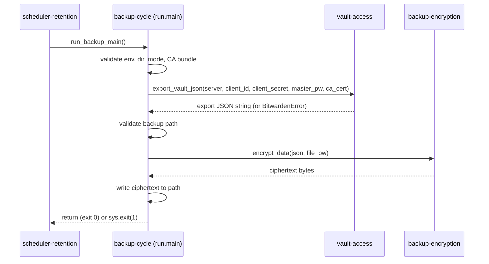

# backup-cycle

## Context and Design Philosophy

backup-cycle is one attempt to produce one backup file. The supervisor (scheduler-retention) calls it on a timer; it reads configuration from the environment, hands credentials to vault-access, receives the vault export as a string, encrypts it through backup-encryption, places the result in the backup directory, and returns. It owns no long-lived state and never retries on its own.

Its guiding principle is **fail loudly, one cycle at a time**. Any problem with configuration, the vault export, or the destination path ends the cycle with exit status 1 and an error log line. The supervisor decides what happens next; this segment never degrades into a partial or silently wrong backup. The companion principle is **plaintext never touches disk**: the export is encrypted in memory and only ciphertext is written.

## Configuration Intake

All configuration arrives as environment variables:

| Variable | Required | Default | Validation | On failure |
|----------|----------|---------|------------|------------|
| `BW_CLIENT_ID` | yes | — | non-empty | fail the cycle |
| `BW_CLIENT_SECRET` | yes | — | non-empty | fail the cycle |
| `BW_PASSWORD` | yes | — | non-empty | fail the cycle |
| `BW_SERVER` | yes | — | non-empty | fail the cycle |
| `BW_FILE_PASSWORD` | yes | — | non-empty | fail the cycle |
| `BACKUP_DIR` | no | `/app/backups` | resolved path must lie under `/app` | critical log, exit 1 |
| `BACKUP_ENCRYPTION_MODE` | no | `raw` | lower-cased, stripped, must be `raw` | critical log explaining that only raw mode exists, exit 1 |
| `BW_CA_CERT` | no | unset | file must exist and be readable | fail the cycle naming the path |
| `LOG_FILE` | no | unset | none | — (adds a `FileHandler`) |

Required-variable checks happen before any network activity. The directory check resolves symlinks before comparing against `/app`. After validation the backup directory is created with mode `0o700` if absent; an existing directory, such as a mounted volume, keeps whatever mode it has.

`BACKUP_ENCRYPTION_MODE` is accepted for one reason: a deployment that still sets it to `bitwarden` must stop with a clear message rather than silently start writing files in a different format, because the operator's restore procedure changes (from `bw import` to the standalone decrypt tool). The variable has no other effect.

## Cycle Flow

The vault client is a single call that encapsulates authentication, key derivation, sync, and decryption; backup-cycle neither sees nor stores the intermediate secrets. A `BitwardenError` from that call logs `Export failed` with the error text and calls `sys.exit(1)`. Encryption and the write follow only on success. There is no logout step: the vault client discards its own token and key material before returning.

The `SystemExit` raised by `sys.exit(1)` propagates to the supervisor, which catches it and records the failed cycle without terminating the service.

## File Naming and Placement

The filename is `backup_<YYYYMMDD_HHMMSS>.enc` using the container's local time. Immediately before the write, the path is checked: it must resolve within the backup directory, the filename must match `^[a-zA-Z0-9._-]+$`, and it must end in `.enc`. Any failure raises an error and nothing is written. This is a second containment layer below the directory-level `/app` check; it exists so that the write path is validated even if a caller other than `run.main` ever supplies a filename.

The export string is encrypted via backup-encryption and written with `open(path, "wb")`; file permissions follow the process umask.

## Decisions & Alternatives

| Decision | Chosen | Alternatives Considered | Rationale |
|----------|--------|------------------------|-----------|
| Failure model | Fail the whole cycle with exit 1 at the first error; no in-cycle retry beyond what vault-access does | Partial success; retry the cycle internally | The supervisor already schedules the next attempt; a half-written backup is worse than none. |
| Encryption modes | Raw mode only | Keep a Bitwarden-native password-protected export as a second mode | Raw mode is restorable with the standalone decrypt tool and never depends on Bitwarden tooling, which is the disaster-recovery posture the project exists for (tenet: *Portable beats native*). The native-export mode existed only because the `bw` CLI could produce it. |
| `BACKUP_ENCRYPTION_MODE` set to `bitwarden` | Fail with an explanatory error | Warn and proceed in raw mode; ignore silently | Proceeding would change the on-disk format, and therefore the restore procedure, without the operator's knowledge. A hard stop forces the one-time acknowledgement. |
| Self-signed servers | `BW_CA_CERT` path, validated before use | A verify-off switch | Trusting a named CA gives the same convenience without exposing the master password hash to an interposed host; checking the file up front turns a typo into a clear error instead of a TLS failure deep in the client. |
| Session cleanup | None in this segment; the vault client discards its own secrets | Explicit logout call | An API-key token has no server-side session; the client's own cleanup is the only thing that matters. |
| Configuration source | Environment variables only | File-based secrets (`*_FILE` variables); config file | Simplest for Docker Compose. Environment variables are visible via `docker inspect`; file-based secrets remain an open request. |
| Directory containment | Resolve and require a prefix of `/app` | Trust `BACKUP_DIR` as given | Prevents a misconfigured or malicious `BACKUP_DIR` from writing or (via retention) deleting outside the application tree. |
| Per-file containment and filename rules | Validate again at write time with a strict character class and `.enc` suffix | Rely on the directory check alone | Defence in depth; the write-time check is independent of how the path was built. |
| Filename timestamp | Local time, second resolution | UTC; ISO 8601 with zone | Human-readable on the host. |

## Open Questions & Future Decisions

### Resolved
1. ✅ **Raw mode is the only mode.** `BACKUP_ENCRYPTION_MODE` survives solely to reject a stale `bitwarden` setting with an explanation.

### Deferred
1. **Unify failure shape.** Missing required variables raise `RuntimeError`; other failures `sys.exit(1)`. Both end the cycle, but the supervisor logs them differently.
2. **Backup file permissions.** Written files inherit the umask. Setting `0o600` explicitly would match the directory's `0o700`.
3. **`LOG_FILE` guidance.** The example path `/var/log/cron.log` is not writable by UID 1000 on the distroless image.
4. **Dead `CRON_EXPRESSION`.** Listed in `.env-example`, read by nothing.
5. **Single logging configuration.** `logging.basicConfig` is called in three modules; only the first takes effect.
6. **Tests.** A fake vault client would allow testing validation, the exit contract, and the write without a server.
7. **File-based secrets.** Support for `BW_PASSWORD_FILE`-style inputs is referenced in the README as an open issue.
8. **Retire `BACKUP_ENCRYPTION_MODE` entirely** once deployments have had time to drop the setting.

## References

- Sibling segments: vault-access (produces the export string; owns `BW_CA_CERT`'s meaning), backup-encryption (raw-mode ciphertext), scheduler-retention (caller; interprets exit status)
- README.md § Configuration (operator-facing table of the same variables)
