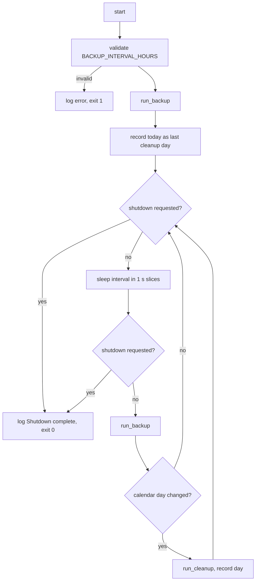

# scheduler-retention

## Context and Design Philosophy

scheduler-retention is the container's process 1. The runtime image is distroless, with no shell and no cron, so the supervisor that used to be a shell script and a crontab is a single Python module (`entrypoint.py`). It has three jobs: run a backup cycle on a fixed interval, prune old backup files once a day, and exit promptly and cleanly when Docker asks it to stop.

The design leans two ways:

- **The service outlives any one failure.** A backup cycle that fails is logged and the schedule continues. A vault that is briefly unreachable at 03:00 should not take the backup service down until someone notices.
- **Shutdown is prompt.** Docker gives a container ten seconds after SIGTERM. The supervisor never sleeps for longer than one second at a time, so a stop request is honoured almost immediately when idle.

## Interval Loop

`BACKUP_INTERVAL_HOURS` defaults to 12 and must be an integer from 1 to 8760; anything else is fatal before the first backup (entrypoint.py:36-46). One backup runs immediately on startup (L118-119), then the loop sleeps the full interval and runs again (L124-129).

`run_backup` (L61-73) calls `run.main` from the backup-cycle segment and absorbs its outcome: a normal return or `SystemExit` with code 0/None logs success; any other `SystemExit` logs the exit code; any other exception is logged with its traceback. None of these stop the loop.

The module locates `run.py` by inserting `/app` at the front of `sys.path` (L16-18), matching the Dockerfile's flat copy of `src/` into `/app`.

## Retention Cleanup

Cleanup is triggered by the calendar, not by a timer: after each backup cycle, if `date.today()` differs from the day recorded at the last cleanup (or at startup), `run_cleanup` runs once and the day is updated (L121, L131-134). With a 12-hour interval, cleanup therefore happens within 12 hours after local midnight, not at midnight.

`RETAIN_DAYS` (L49-58) defaults to 7. A value that is not a non-negative integer, or is 0, disables cleanup with an info log. A value above 3650 disables cleanup with an error log. Neither is fatal.

`run_cleanup` (L76-98) deletes every entry in `BACKUP_DIR` (default `/app/backups`) that is a regular file, not a symlink, has the suffix `.enc`, and has a modification time older than `RETAIN_DAYS × 86400` seconds. Other entries are left alone. If the directory does not exist, cleanup logs a warning and returns. The number of files removed is logged.

The directory path is taken from `BACKUP_DIR` as-is. The backup cycle confines the same variable to `/app` before writing (src/run.py:25-45); the cleanup path does not repeat that check before deleting.

## Signals and Shutdown

SIGTERM and SIGINT set a module-level flag (L27-33, L112-113). `_sleep_interruptible` (L101-108) sleeps in slices of at most one second and returns as soon as the flag is set. The main loop checks the flag after sleeping and before each new cycle (L124-127). A signal that arrives during a backup cycle does not interrupt it; the cycle finishes, the day-rollover cleanup check still runs, and then the loop exits. Shutdown logs `Shutdown complete` and the process ends with status 0 (L136).

## Decisions & Alternatives

| Decision | Chosen | Alternatives Considered | Rationale |
|----------|--------|------------------------|-----------|
| Supervisor implementation | A Python module as PID 1 | Shell `entrypoint.sh` + cron (`cleanup.sh`); an init system such as `tini` or `supercronic` | Module docstring: the runtime image is shell-free (distroless), so the supervisor must not need `/bin/sh` or a cron daemon. Replacing the two scripts removes the shell dependency entirely. |
| Scheduling model | Fixed interval in hours | Cron expression; fixed time of day | `[inferred]` Simplest to validate and reason about; `CRON_EXPRESSION` still appears in `.env-example` as a remnant. |
| Cleanup trigger | After the first backup on a new calendar day | Separate timer or thread; cron | `[inferred]` Avoids a second timer in a single-threaded loop. Cost: cleanup latency of up to one interval after midnight. |
| Failed-cycle policy | Log and continue, no back-off, no failure limit | Exit on failure and let Docker restart; exponential back-off | `[inferred]` A transient vault outage should not stop future backups. Cost: a permanently broken configuration logs forever without surfacing a health signal. |
| Sleep granularity | 1 s slices | Single long `time.sleep`; `signal.pause` | `[inferred]` Keeps SIGTERM response under one second without async machinery. |
| Deletion rules | Regular, non-symlink `*.enc` by mtime only | Delete by filename timestamp; delete anything older than N days | `[inferred]` Never follows symlinks or touches non-backup files that may share the mounted volume. |
| Validation severity | Interval errors fatal; retention errors disable cleanup | Both fatal; both soft | `[inferred]` Without a valid interval there is nothing to run; without valid retention the backups themselves are unaffected. |

## Open Questions & Future Decisions

### Resolved
*(none yet — inferred decisions above await confirmation)*

### Deferred
1. **Containment before deletion.** Apply the `/app` prefix check to `BACKUP_DIR` in `run_cleanup`, matching the backup cycle (SCHED-RETAIN-008 is tracked as a gap).
2. **"Midnight" wording.** Either the README changes to describe the day-rollover trigger, or the trigger moves to a time-based schedule.
3. **Health signal.** No heartbeat file, exit-on-N-failures, or `HEALTHCHECK`. Decide whether a stuck or always-failing service should be observable from outside the logs.
4. **Signal during a cycle.** The cycle runs to completion before shutdown. With a slow vault this can exceed Docker's default 10 s stop grace and result in SIGKILL mid-export. Decide whether that is acceptable or whether the grace period should be documented.
5. **Import path.** The hardcoded `/app` on `sys.path` prevents running `entrypoint.py` from a checkout. A package layout or an environment-driven path would remove the coupling.
6. **Lint coverage.** CI lints `src/` only; `entrypoint.py` is excluded.
7. **Tests.** None. Time, filesystem, and `run.main` can all be faked.

## References

- Sibling segments: backup-cycle (the work each tick performs; exit status contract), image-delivery (the distroless base that motivates a shell-free supervisor)
- Docker stop grace period: https://docs.docker.com/reference/cli/docker/container/stop/
