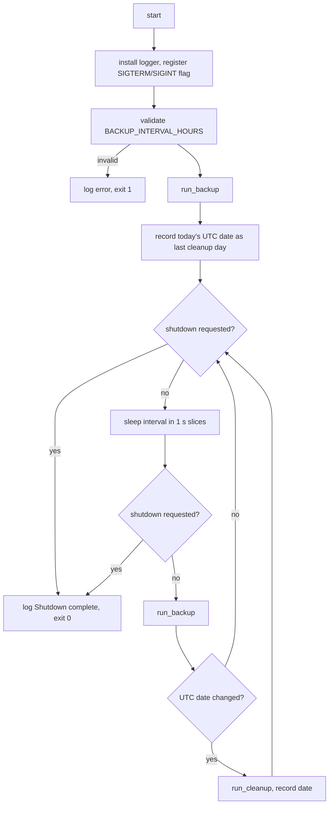

# scheduler-retention

## Context and Design Philosophy

scheduler-retention is the container's process 1: the `main` of the `backvault` service binary. The runtime image is distroless, with no shell and no cron, so the supervisor is the program itself. It has four jobs: install logging once, run a backup cycle on a fixed interval, prune old backup files once a day, and exit promptly and cleanly when Docker asks it to stop.

The design leans two ways:

- **The service outlives any one failure.** A backup cycle that fails, or even panics, is logged and the schedule continues. A vault that is briefly unreachable at 03:00 should not take the backup service down until someone notices.
- **Shutdown is prompt.** Docker gives a container ten seconds after SIGTERM. The supervisor never sleeps for longer than one second at a time, so a stop request is honoured almost immediately when idle.

## Logging

After the `--version` check, the supervisor installs the process-wide `log` backend before anything else runs. The backend is a small hand-written `log::Log` implementation: each record is one line, `YYYY-MM-DDTHH:MM:SSZ LEVEL message`, written to stdout. Where `LOG_FILE` is set, the same lines are also appended to that file, which is created if absent. If the file cannot be opened, the failure is logged to stdout and the service continues with stdout alone; a logging problem must never stop backups. Every other segment emits through the facade and configures nothing.

## Interval Loop

`backvault --version` prints the name and version and exits 0 before anything else happens; the image smoke test in CI relies on it, since the service never exits on its own. `BACKUP_INTERVAL_HOURS` defaults to 12 and must be an integer from 1 to 8760; anything else is fatal before the first backup. One backup runs immediately on startup, then the loop sleeps the full interval and runs again.

`run_backup` calls backup-cycle's `cycle::run` inside `std::panic::catch_unwind` and absorbs its outcome: `Ok(path)` logs success with the path; `Err(CycleError)` logs the error at ERROR; a panic logs the panic payload at ERROR. None of these stop the loop.

The loop is a `Supervisor` struct generic over a `CycleRunner` (production: `cycle::run`), a `Clock` (UTC date and time; the one trait definition, which backup-cycle also consumes for its filename timestamp), and a `Sleeper` (one-second slices), sharing an `Arc<AtomicBool>` shutdown flag with the signal handler. Tests substitute all four.

## Retention Cleanup

Cleanup is triggered by the calendar, not by a timer: after each backup cycle, if the current UTC date differs from the date recorded at the last cleanup (or at startup), `run_cleanup` runs once and the date is updated. With a 12-hour interval, cleanup therefore happens within one interval after midnight UTC, not at midnight.

`RETAIN_DAYS` defaults to 7. A value that is not a non-negative integer, or is 0, disables cleanup with an info log. A value above 3650 disables cleanup with an error log. Neither is fatal.

Before deleting anything, `run_cleanup` confines `BACKUP_DIR` (default `/app/backups`) with the same canonicalise-and-require-`/app`-prefix check the backup cycle applies before writing; the check is backup-cycle's `cycle::confine_to_app`. A directory outside `/app` logs an error and skips cleanup. It then deletes every entry that is a regular file, not a symlink, has the suffix `.enc` or `.enc.part` (an abandoned partial write), and has a modification time older than `RETAIN_DAYS × 86400` seconds. Other entries are left alone. If the directory does not exist, cleanup logs a warning and returns. The number of files removed is logged.

## Signals and Shutdown

SIGTERM and SIGINT set the shared atomic flag through `signal-hook`'s flag registration, which is async-signal-safe and does nothing else in the handler. The sleeper sleeps in slices of at most one second and returns as soon as the flag is set. The main loop checks the flag after sleeping and before each new cycle. A signal that arrives during a backup cycle does not interrupt it; the cycle finishes, the day-rollover cleanup check still runs, and then the loop exits. Shutdown logs `Shutdown complete` and the process ends with status 0.

## Decisions & Alternatives

| Decision | Chosen | Alternatives Considered | Rationale |
|----------|--------|------------------------|-----------|
| Supervisor implementation | The service binary's own `main` loop as PID 1 | Shell `entrypoint.sh` + cron; an init system such as `tini` or `supercronic`; a separate supervisor binary | The runtime image is shell-free and holds one executable; the loop is forty lines and needs nothing an init system provides. |
| Log backend | Hand-written `log::Log` writing stdout and optionally `LOG_FILE` | `env_logger`; `simplelog`; `tracing-subscriber` | One fixed line format and two sinks do not justify a logging framework's tree (tenet: *Small tree beats convenient crate*). |
| Unopenable `LOG_FILE` | Log to stdout and continue | Exit 1 | The file is a convenience; the backups are the point. |
| Scheduling model | Fixed interval in hours | Cron expression; fixed time of day | `[inferred]` Simplest to validate and reason about; `CRON_EXPRESSION` still appears in `.env-example` as a remnant. |
| Cleanup trigger | After the first backup on a new UTC calendar day | Separate timer or thread; cron | `[inferred]` Avoids a second timer in a single-threaded loop. Cost: cleanup latency of up to one interval after midnight. |
| Calendar | UTC | Container local time | A static image carries no timezone database, so local time is UTC in practice; saying so makes the behaviour the same on every host. |
| Failed-cycle policy | Log and continue, no back-off, no failure limit; panics are caught | Exit on failure and let Docker restart; exponential back-off; let a panic abort | `[inferred]` A transient vault outage should not stop future backups; a bug in one cycle is the same from the operator's view as a failed cycle. Cost: a permanently broken configuration logs forever without surfacing a health signal. |
| Signal handling | `signal-hook` flag registration | Raw `libc` handlers; `ctrlc`; `tokio::signal` | The flag API is async-signal-safe by construction and is the smallest correct option without an async runtime. |
| Sleep granularity | 1 s slices | A single long sleep; condvar wake from the handler | `[inferred]` Keeps SIGTERM response under one second with nothing shared but an atomic. |
| Deletion rules | Regular, non-symlink `*.enc` and `*.enc.part` by mtime only, inside a confined directory | Delete by filename timestamp; delete anything older than N days | `[inferred]` Never follows symlinks or touches non-backup files that may share the mounted volume; the containment check is the same one the writer uses, so the two can never disagree. |
| Validation severity | Interval errors fatal; retention errors disable cleanup | Both fatal; both soft | `[inferred]` Without a valid interval there is nothing to run; without valid retention the backups themselves are unaffected. |
| Dependency injection | `CycleRunner`, `Clock`, `Sleeper` traits and a shared flag | Call the cycle, clock, and `thread::sleep` directly | Every loop, signal, and retention spec becomes testable in milliseconds, which the previous untested design lacked. |

## Open Questions & Future Decisions

### Resolved
1. ✅ **Cleanup is confined to `/app`** by the same function the backup cycle uses.
2. ✅ **The supervisor is the binary**; no import path, no shell, lint and tests cover it like any other module.
3. ✅ **Logging is installed once, here.** `LOG_FILE` is this segment's variable.

### Deferred
1. **"Midnight" wording.** The README describes cleanup as happening at midnight; it happens after the first cycle of a new UTC day. The README changes when the Rust service lands.
2. **Health signal.** No heartbeat file, exit-on-N-failures, or `HEALTHCHECK`. Decide whether a stuck or always-failing service should be observable from outside the logs.
3. **Signal during a cycle.** The cycle runs to completion before shutdown. With a slow vault this can exceed Docker's default 10 s stop grace and result in SIGKILL mid-export; the `.part`-then-rename write in backup-cycle means a killed cycle leaves at most an abandoned `.part` file, never a truncated `.enc`. Decide whether to document a longer `stop_grace_period` in the Compose reference.

## Cascade Notes

- **backup-cycle**: supplies `cycle::run` and `CycleError`; shares the `/app` containment function.
- **delivery**: the image's entrypoint is this binary and its smoke test is `--version`; the Compose reference may gain `stop_grace_period`.

## References

- `signal-hook`: https://docs.rs/signal-hook
- `log` facade: https://docs.rs/log
- Sibling segments: backup-cycle (the work each tick performs), delivery (the distroless base that motivates a shell-free supervisor)
- Docker stop grace period: https://docs.docker.com/reference/cli/docker/container/stop/
